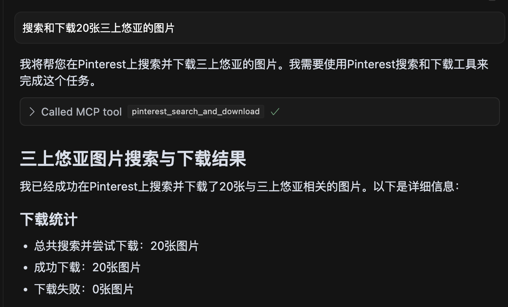

[](https://mseep.ai/app/terryso-mcp-pinterest)

# Pinterest MCP Server

[](https://badge.fury.io/js/pinterest-mcp-server)

[](https://mseep.ai/app/23da55f4-6d6a-4dc9-af31-cd6073eb1b27)

A Model Context Protocol (MCP) server for Pinterest image search and information retrieval.

This project is an **unofficial scraper**. It reads public Pinterest pages with a headless browser and does not use the official Pinterest API, which may conflict with Pinterest's Terms of Service. It is meant for personal and local development use. Pinterest's own products, and any official MCP server, are separate.

`pinterest-mcp-server` speaks MCP over **stdio**. Running the command does not open a website. Configure it in an MCP client (Cursor, Claude Desktop, or another client that launches a stdio server) with `npx -y pinterest-mcp-server` or the global `pinterest-mcp-server` bin.

## Features

- Search for images on Pinterest by keywords
- Retrieve detailed information about Pinterest images
- Seamless integration with Cursor IDE through MCP
- Support for headless browser mode
- Limit control for search results
- Search and download images from Pinterest

## Prerequisites

- [Node.js](https://nodejs.org/) (v18 or higher)
- [Cursor IDE](https://cursor.sh/) for MCP integration

## Installation

### Using NPX (Recommended)

The easiest way to use Pinterest MCP Server is via npx:

```bash
npx pinterest-mcp-server
```

You can configure the server with command-line options:

```bash
# Specify download directory
npx pinterest-mcp-server --downloadDir /path/to/downloads

# Specify filename template
npx pinterest-mcp-server --filenameTemplate "pinterest_{id}"

# Specify both options
npx pinterest-mcp-server --downloadDir ./images --filenameTemplate "pinterest_{id}"
```

### Global Installation

To install the package globally and use it directly from the command line:

```bash
npm install -g pinterest-mcp-server
```

After installation, you can run the server with:

```bash
pinterest-mcp-server
```

With the same command line options as the NPX version:

```bash
pinterest-mcp-server --downloadDir /path/to/downloads --filenameTemplate "pinterest_{id}"
```

### Smithery (unavailable)

Do not use the old Smithery one-click install. The server page on smithery.ai returns **404**, so this command cannot install the server:

```bash
npx -y @smithery/cli install mcp-pinterest --client claude
```

Configure Cursor or Claude Desktop directly, as shown below. `Dockerfile` and `smithery.yaml` remain in the repo for people who run the stdio process themselves. They do not bring the Smithery listing back.

### Manual Installation

1. Clone this repository:
   ```bash
   git clone https://github.com/terryso/mcp-pinterest.git pinterest-mcp-server
   cd pinterest-mcp-server
   ```

2. Install dependencies:
   ```bash
   npm install
   ```

3. Build the server:
   ```bash
   npm run build
   ```

4. Run the server:
   ```bash
   npm start
   ```

## Configuring as MCP Server in Cursor

1. Open Cursor IDE
2. Go to Settings (⚙️) > Extensions > MCP
3. Click "Add Server"
4. Enter the following details:
   - Name: Pinterest MCP
   - Type: Command
   - Command: `node`
   - Args: `["/path/to/mcp-pinterest/dist/pinterest-mcp-server.js"]`

   或者直接编辑Cursor的MCP配置文件（通常位于`~/.cursor/mcp.json`），添加以下内容：
   ```json
   "pinterest": {
     "command": "node",
     "args": ["/path/to/mcp-pinterest/dist/pinterest-mcp-server.js"]
   }
   ```
5. Click "Save"

### Alternative: Using NPX for Cursor Configuration

You can also configure Cursor to use the npx version of the server:

1. Open Cursor IDE
2. Go to Settings (⚙️) > Extensions > MCP
3. Click "Add Server"
4. Enter the following details:
   - Name: Pinterest MCP
   - Type: Command
   - Command: `npx`
   - Args: `["-y", "pinterest-mcp-server"]`
5. Click "Save"

`-y` lets the client install the package without an interactive prompt.

### Claude Desktop

Claude Desktop does not use the Smithery install. Edit the Claude Desktop config (`claude_desktop_config.json`) and restart the app:

```json
{
  "mcpServers": {
    "pinterest": {
      "command": "npx",
      "args": ["-y", "pinterest-mcp-server"]
    }
  }
}
```

A global install works the same way with `"command": "pinterest-mcp-server"` and `"args": []`.

### Complete Configuration Example with Environment Variables

For the most flexibility, you can configure the server with environment variables in your Cursor MCP configuration:

```json
"pinterest": {
  "command": "npx",
  "env": {
    "MCP_PINTEREST_DOWNLOAD_DIR": "/Users/xxx/Desktop/Images",
    "MCP_PINTEREST_FILENAME_TEMPLATE": "pin_{imageId}_{timestamp}.{fileExtension}",
    "MCP_PINTEREST_PROXY_SERVER": "http://127.0.0.1:7890"
  },
  "args": ["-y", "pinterest-mcp-server"]
}
```

This configuration:
- Uses npx to run the server
- Sets a custom download directory on your desktop
- Uses a custom filename template with both image ID and timestamp
- Configures a proxy server for users in regions where Pinterest might be blocked

Add this to your `~/.cursor/mcp.json` file or set up through the Cursor IDE interface.

## Available MCP Functions

The server exposes the following MCP functions:

- `pinterest_search`: Search for images on Pinterest by keyword
  - Parameters:
    - `keyword`: Search term (required)
    - `limit`: Number of images to return (default: 10)
    - `headless`: Whether to use headless browser mode (default: true)

- `pinterest_get_image_info`: Get detailed information about a Pinterest image
  - Parameters:
    - `image_url`: URL of the Pinterest image (required)

- `pinterest_search_and_download`: Search and download images from Pinterest
  - Parameters:
    - `keyword`: Search term (required)
    - `limit`: Number of images to return (default: 10)
    - `headless`: Whether to use headless browser mode (default: true)

## Example Usage in Cursor

Once configured, you can use the Pinterest MCP functions directly in Cursor's AI chat:

```
Search for robot images on Pinterest
```

The AI will use the MCP server to search Pinterest and display the results.

### Example Screenshot



*Screenshot showing a search for 20 images of 三上悠亚 with all images successfully downloaded.*

## Docker

The repository includes a `Dockerfile`. It builds the TypeScript server and starts it on stdio (`node dist/pinterest-mcp-server.js`):

```bash
docker build -t pinterest-mcp-server .
docker run -i --rm pinterest-mcp-server
```

Glama's directory can still show the server as unavailable until the repository owner Claims the listing and registers this Dockerfile in the Glama admin UI. That step needs the owner's Glama account.

## Development

### Project Structure

- `pinterest-mcp-server.ts`: Main server file
- `dist/pinterest-mcp-server.js`: Built JavaScript file for production
- `package.json`: Project configuration and dependencies

### Adding New Features

To add new MCP functions:

1. Modify `pinterest-mcp-server.ts`
2. Register new functions using the MCP SDK
3. Implement the function logic
4. Rebuild with `npm run build`

## Troubleshooting

- If the client cannot connect, confirm it launches this command as a stdio MCP server. Logs belong on stderr; stdout is only for JSON-RPC
- Ensure all dependencies are correctly installed with `npm install`
- Make sure TypeScript is properly configured with a `tsconfig.json` file
- If you encounter build errors, try running `npm install -D typescript @types/node`
- Verify network connectivity for Pinterest access

## License

This project is licensed under the MIT License - see the [LICENSE](LICENSE) file for details.

## Configuration Options

### Command Line Options (NPX Mode)

When using the server via npx, you can configure it using the following command line options:

- `--downloadDir`: Specifies the root directory for downloading images
  ```bash
  npx pinterest-mcp-server --downloadDir /path/to/downloads
  ```

- `--filenameTemplate`: Specifies the filename template for downloaded images
  ```bash
  npx pinterest-mcp-server --filenameTemplate "pin_{imageId}_{timestamp}"
  ```

This server does not listen on a TCP port. MCP clients talk to it over stdin and stdout. `--port` is ignored.

- `--proxyServer`: Specifies the proxy server to use for connecting to Pinterest. This sets `MCP_PINTEREST_PROXY_SERVER`.
  ```bash
  npx pinterest-mcp-server --proxyServer "http://127.0.0.1:7890"
  ```

You can combine multiple options:
```bash
npx pinterest-mcp-server --downloadDir ./images --filenameTemplate "pinterest_{id}" --proxyServer "http://127.0.0.1:7890"
```

### Environment Variables

The server also supports the following environment variables for configuration:

- `MCP_PINTEREST_DOWNLOAD_DIR`: Specifies the root directory for downloading images. If not set, the default is the `../downloads` directory relative to the server script.
- `MCP_PINTEREST_FILENAME_TEMPLATE`: Specifies the filename template for downloaded images. If not set, the default is `pinterest_{imageId}.{fileExtension}`.
- `MCP_PINTEREST_PROXY_SERVER`: Specifies the proxy server to use for connecting to Pinterest. Format should be `protocol://host:port`, for example `http://127.0.0.1:7890` or `socks5://127.0.0.1:1080`.

These environment variables can be set in several ways:
1. Directly in your terminal (as shown in the examples below)
2. In your Cursor or Claude Desktop MCP configuration through the `env` field (see [Complete Configuration Example](#complete-configuration-example-with-environment-variables))
3. Through command line options with npx (as shown in the [Command Line Options](#command-line-options-npx-mode) section)

The server does not load a `.env` file by itself.

### Usage

#### Setting Download Directory

1. Using npx with command line options:
```bash
npx pinterest-mcp-server --downloadDir /path/to/your/download/directory
```

2. Set the download directory using an environment variable:

```bash
# Linux/macOS
export MCP_PINTEREST_DOWNLOAD_DIR=/path/to/your/download/directory
npx pinterest-mcp-server

# Windows (CMD)
set MCP_PINTEREST_DOWNLOAD_DIR=C:\path\to\your\download\directory
npx pinterest-mcp-server

# Windows (PowerShell)
$env:MCP_PINTEREST_DOWNLOAD_DIR="C:\path\to\your\download\directory"
npx pinterest-mcp-server
```

3. If the environment variable is not set, the server will use the default download directory (relative to the server script's `../downloads`).

#### Setting Filename Template

1. Using npx with command line options:
```bash
npx pinterest-mcp-server --filenameTemplate "pin_{imageId}_{timestamp}.{fileExtension}"
```

2. Using an environment variable:

```bash
# Linux/macOS
export MCP_PINTEREST_FILENAME_TEMPLATE="pin_{imageId}_{timestamp}.{fileExtension}"
npx pinterest-mcp-server

# Windows (CMD)
set MCP_PINTEREST_FILENAME_TEMPLATE="pin_{imageId}_{timestamp}.{fileExtension}"
npx pinterest-mcp-server

# Windows (PowerShell)
$env:MCP_PINTEREST_FILENAME_TEMPLATE="pin_{imageId}_{timestamp}.{fileExtension}"
npx pinterest-mcp-server
```

The template supports the following variables:
- `{imageId}`: The unique ID of the Pinterest image
- `{fileExtension}`: The file extension (e.g., jpg, png)
- `{timestamp}`: Current UTC timestamp in YYYYMMDDHHMMSS format
- `{index}`: The index number when downloading multiple images (starts from 1)

Example templates:
- `pinterest_{imageId}.{fileExtension}` (default)
- `pin_{timestamp}_{imageId}.{fileExtension}`
- `pinterest_image_{index}_{imageId}.{fileExtension}`
- `{timestamp}_pinterest.{fileExtension}`

If the template is invalid (e.g., contains unsupported variables or has mismatched brackets), the server will log a warning and use the default template.

#### Setting Proxy Server

If you need to use a proxy to access Pinterest (especially in regions where Pinterest might be restricted), you can set the proxy configuration:

1. Using npx with command line options:
```bash
npx pinterest-mcp-server --proxyServer "http://127.0.0.1:7890"
```

2. Using an environment variable:

```bash
# Linux/macOS
export MCP_PINTEREST_PROXY_SERVER="http://127.0.0.1:7890"
npx pinterest-mcp-server

# Windows (CMD)
set MCP_PINTEREST_PROXY_SERVER=http://127.0.0.1:7890
npx pinterest-mcp-server

# Windows (PowerShell)
$env:MCP_PINTEREST_PROXY_SERVER="http://127.0.0.1:7890"
npx pinterest-mcp-server
```

Supported proxy protocols:
- HTTP: `http://host:port`
- HTTPS: `https://host:port`
- SOCKS4: `socks4://host:port`
- SOCKS5: `socks5://host:port`

The proxy configuration affects both the browser used for searching and the image downloading process.

#### Notes

- The server will verify the existence and writability of the download directory when starting. If the directory does not exist, it will attempt to create it; if it cannot be created or written to, the server will exit.
- Clients should not specify download paths or filename templates through parameters when calling download-related tools, as all downloads will use the server's environment variable configuration or defaults.
- The server automatically sanitizes filenames by replacing illegal characters (such as `/`, `\`, `:`, `*`, `?`, `"`, `<`, `>`, `|`) with underscores.

#### Interface Description

The server provides the following MCP tools:

1. `pinterest_search`: Search for Pinterest images by keyword
2. `pinterest_get_image_info`: Get detailed information about a Pinterest image
3. `pinterest_search_and_download`: Search and download Pinterest images

For detailed interface parameter references, please refer to the MCP tool definitions. 

## ⭐ Star History

[](https://www.star-history.com/#terryso/mcp-pinterest&Date)
